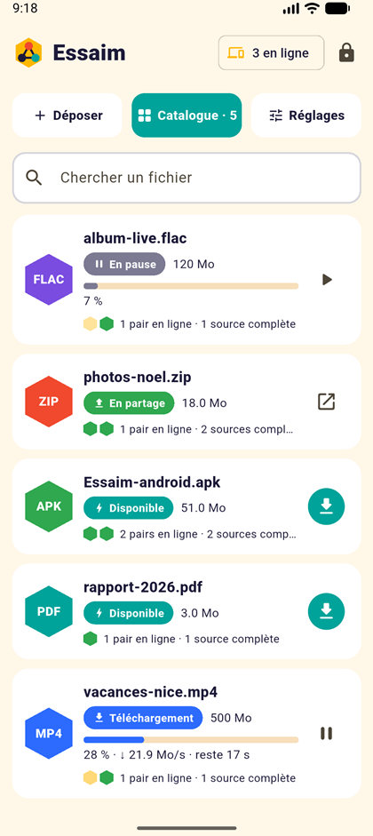
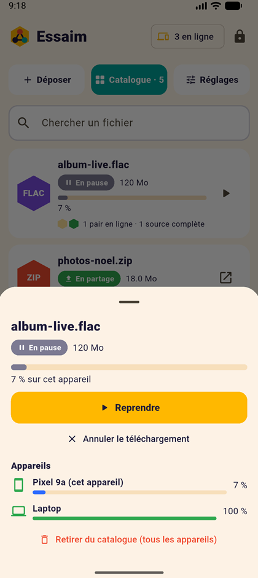
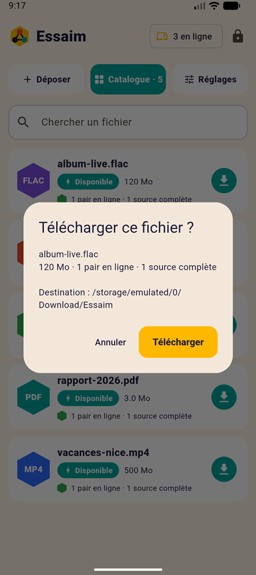
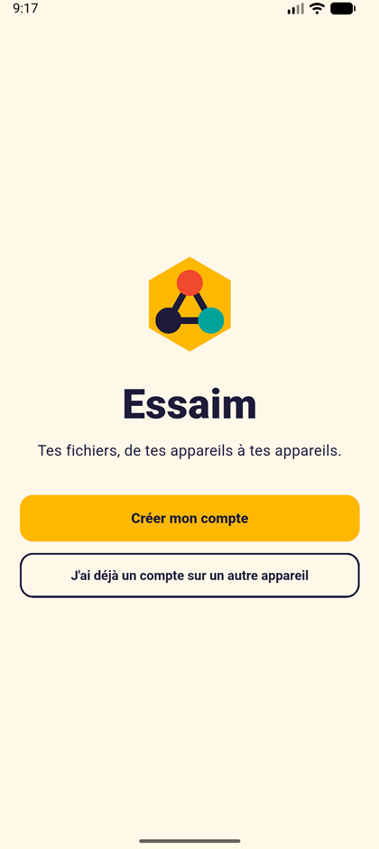
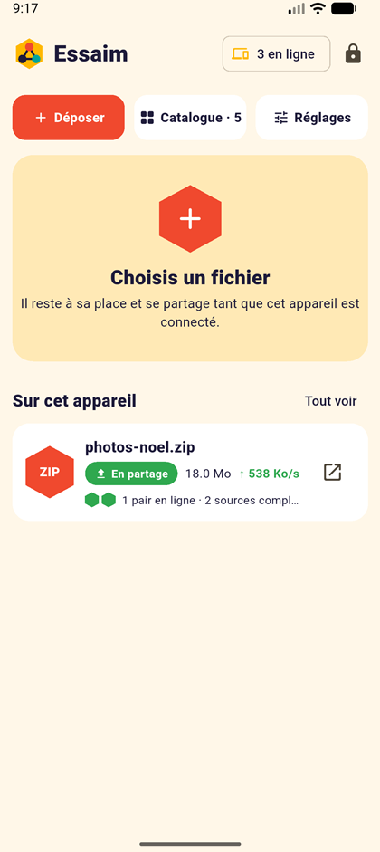
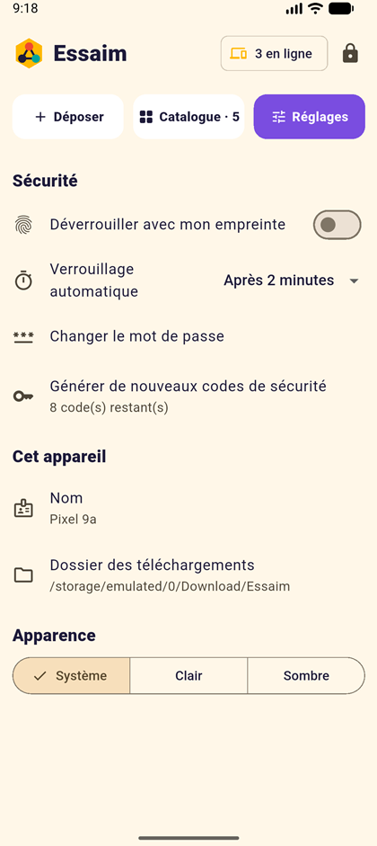

<p align="center"></p>
<h1 align="center">Essaim</h1>
<p align="center">Partage de fichiers en P2P entre tes propres appareils, à travers Tailscale. Sans serveur.</p>

<p align="center">
  
  
  
</p>
<p align="center">
  
  
  
</p>
<p align="center"><sub>Captures réelles de l'app, avec des fichiers de démonstration.</sub></p>

## Fonctionnement

Tu déposes un fichier sur un appareil : il reste à sa place et apparaît dans le catalogue de tous les autres. Chaque appareil qui le télécharge le repartage à son tour, dès les premiers morceaux reçus. Un fichier reste disponible tant qu'au moins un appareil qui le possède est connecté.

- **Statuts clairs :** en partage, terminé, téléchargement, en pause, en attente de pairs, source hors ligne.
- **Suivi par appareil :** nombre de pairs, sources complètes, vitesse, temps restant et pourcentage de chaque appareil.
- **Contrôle :** confirmation avant téléchargement, pause, reprise, bascule en partage / terminé.
- **Un seul compte :** mot de passe commun, codes de secours, ajout d'un appareil par code à 6 chiffres, empreinte sur Android.

## Installation

Télécharge la dernière version dans les [releases](https://github.com/0x80070006/Essaim/releases) :

- **Android 11 ou plus récent :** `Essaim-android.apk`
- **Windows 10/11 x64 :** `Essaim-windows.zip`, à décompresser, puis lancer `essaim.exe`

Tailscale doit être actif sur chaque appareil, sur le même tailnet.

> Projet en préversion : l'APK est signé avec une clé de développement.

## Compiler

Flutter 3.41 ou plus récent. Sous Windows, le mode développeur doit être activé.

```
flutter build apk --release
flutter build windows --release
dart test
```

## Sécurité

- L'API entre pairs n'accepte que les adresses Tailscale, dont le trafic est chiffré par WireGuard. Seules la découverte et l'appairage (SPEKE) répondent sur le réseau local.
- Chaque requête est signée, et chaque morceau est vérifié par SHA-256.
- Le mot de passe et l'empreinte protègent l'accès à l'interface. Le partage continue app verrouillée, avec une clé scellée par le système (Keystore sur Android, DPAPI sur Windows).
- Limite connue : retirer un appareil du compte n'est pas encore possible.